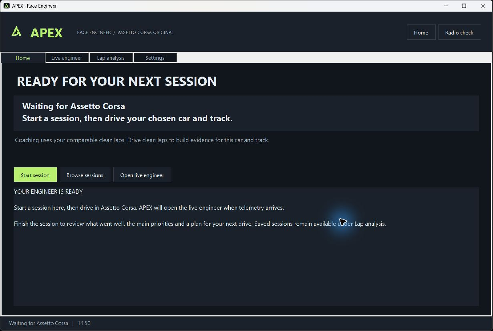

# APEX Race Engineer

A native Windows race engineer for **original Assetto Corsa**, with an in-game overlay, spoken questions and updates, saved lap sheets and session debriefs.

**0.5.1 is an early public playtest.** The focus is useful measured advice, straightforward session flow, wheel/voice compatibility and performance across real AC installations. ACC and AC EVO are unsupported.

## Try it

Download [APEX-Playtest-v0.5.1.zip](https://github.com/arthurjorgefacul-byte/apex-race-engineer/releases/tag/v0.5.1) from the public playtest release. Extract the whole archive and start with its top-level **START-HERE.txt**. The [playtester guide](playtest/START-HERE.md) covers installation and a roughly 20-minute checklist.

Requirements: Windows x64, original Assetto Corsa, Content Manager/CSP, **.NET 10 Windows Desktop Runtime x64** and **Python 3.10+**. A fresh install starts with the APEX local engineer, which needs no account or paid API.

Voice input additionally needs a microphone and the installed Windows **English (United States)** speech recognizer. It uses short predefined English commands through Windows speech recognition; **Whisper is not integrated**. Quick buttons and typed questions remain available without voice input.

## During a session

1. Press **Start session** on Home. Complete the initial partial/out lap and drive comparable clean laps.
2. Ask for fuel, tyres, your best lap, opponents' best laps, race gaps or **feedback**. Bind an unused wheel button or key in Settings for push-to-talk.
3. Inspect measured braking, throttle, exit-speed and available gear differences in **Lap analysis**. Excluded/removed laps are kept separate from references; removal is reversible.
4. Finish with **End session & debrief**. Review useful figures, strengths, priorities and a next-session plan on Home.

Routine coaching waits for lower-workload moments. Urgent available warnings can interrupt. Requested answers can speak while stopped or paused after microphone input closes.

Supported compound requests prepare the **next Quick Pit service** and require a matching game acknowledgement. They do not replace mounted tyres while driving. Garage setups are not automatically changed.

## Feedback and limits

Use [FEEDBACK-TEMPLATE.md](playtest/FEEDBACK-TEMPLATE.md) or a repository issue. Include your car, exact layout, CSP version, wheel/input setup and reproducible steps. Review optional logs, screenshots or selected session exports before attaching them. APEX does not automatically upload recordings; microphone input is local and is not saved.

Detected corner labels are not official circuit turn numbers. Unknown telemetry stays unavailable. Race gaps are estimates requiring fresh CSP race data. The background corpus includes sourced track/category context and human research laps, with **zero verified elite benchmarks**; your own comparable clean laps determine measured comparisons.

Fresh-PC setup, physical G29 holds, full online grids and every wheel/mod/CSP combination have not all been verified. The legacy Windows joystick interface exposes at most 32 buttons per device. See [0.5 validation and limits](docs/RELEASE_0.5.md) and [0.5.1 changes](docs/RELEASE_0.5.1.md).

## Source and credits

APEX is distributed under [GNU AGPL v3](LICENSE), with the original third-party notices preserved. It includes **unmodified AC Pro Engineer v0.5.1**, by Rgosh and contributors, as an optional backend with corresponding source: https://github.com/Rgosh/ac-pro-engineer.

See [CREDITS.md](CREDITS.md), [CPython support provenance](ac_app/RaceEngineer/stdlib/PROVENANCE.json) and [research-data attribution](reference_data/foundations/README.md). Simulator Controller, Crew Chief and Track Titan are not embedded integrations. APEX is not affiliated with Kunos, Content Manager or CSP.

